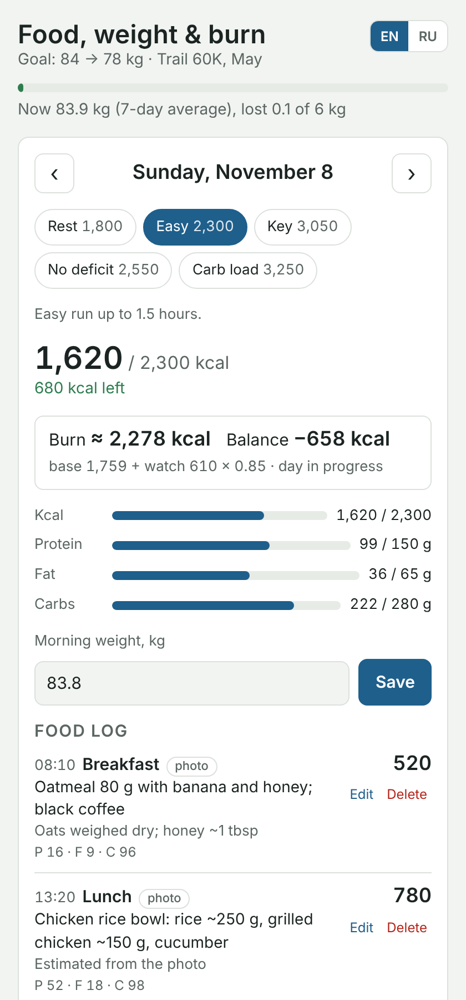
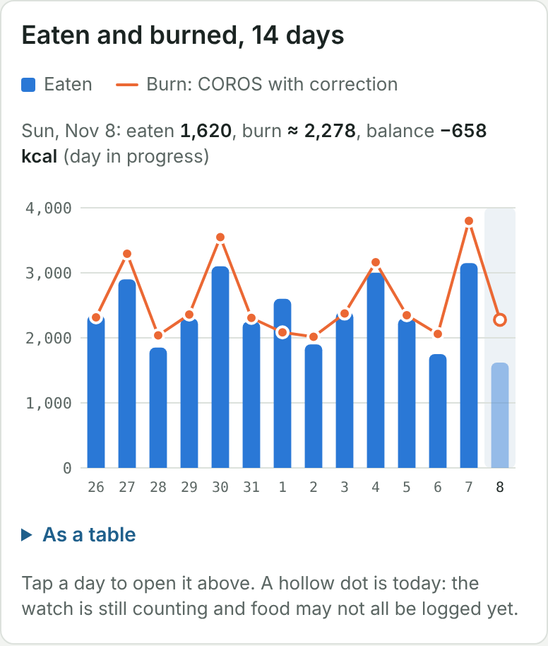

# COROS nutrition log for Claude

[Русская версия](README.ru.md)

A food, weight and burn log that lives inside Claude. You send Claude a photo of your food, Claude estimates calories and macros and writes them to your log page. The page adds daily burn from your COROS watch, shows the balance, and over time learns how far your watch is off by comparing what you eat with your weight trend.

<p>
  
  
</p>

- Food log from photos, labels or a few words, with protein, fat and carbs
- Targets per day type: rest, easy, key, no deficit, carb loading, suggested from your profile or set by hand
- Burn = base metabolism + COROS active calories × a correction factor, fitted from your weight trend
- Morning weight with a 7-day average, weekly balance, 14-day eaten vs burned chart
- English and Russian

## What you need

- A Claude plan where artifacts can use your connected apps (Pro, Max, Team or Enterprise).
- **Create and edit files** (code execution) turned on in Claude's settings: skills and artifacts need it.
- The **COROS** connector added in Claude, for burn data. Without it the log works, just without burn and balance.

## Set it up

1. Download [`claude-coros-nutrition-log.zip`](https://github.com/l3x4/claude-coros-nutrition-log/releases/latest/download/claude-coros-nutrition-log.zip).
2. In Claude open **Customize → Skills**, press **+**, choose **Create skill → Upload a skill** and pick the ZIP. The skill shows up as **coros-nutrition-log**: Claude doesn't allow the word "claude" in skill names.
3. In a new chat write: *Set up my nutrition log.* Claude publishes the page for you.
4. Open the page, allow it to read COROS when asked, and fill **Profile** in Settings: sex, age, height, start and goal weight.

The page is yours: your entries are stored in your own private folder of it, which nobody else can read.

## Use it

Talk to Claude in any chat:

- Send a photo: *breakfast*, *shared this pizza, I had a quarter*. What's in the photo counts as eaten.
- Describe without a photo: *two boiled eggs and toast with butter*.
- *Weight 82.4 this morning.*
- *Today is a key day*, *I'm carb loading tomorrow and the day after.*
- *How am I doing today?*

The day ends when you go to sleep, so a snack after midnight stays with the evening it belongs to. When there's no label or weight in the photo, Claude looks the product up online instead of guessing.

You can also add or fix entries by hand on the page.

## How burn is calculated

- **Base metabolism**: Mifflin–St Jeor from your profile and 7-day average weight.
- **Active calories** come from COROS (the daily summary, nothing else is read) and are multiplied by a factor. It starts at 0.85, because wrist estimates usually run high.
- After 4 weeks with at least 10 weigh-ins and 14 logged days, the factor is fitted so that what you eat, minus the change in your weight (7,700 kcal per kg), matches your burn. That also absorbs systematic errors in the food estimates. You can fix the factor by hand in Settings.
- **Balance** = eaten − burned. Minus is a deficit.

## Without the skill

You can ask Claude to publish `index.html` from this repository as an artifact and declare its capabilities:

```json
{"db": {}, "user": {}, "mcp": {"servers": [{"server": "COROS", "tools": ["queryDailyHealthData"]}]}}
```

The skill is still the easier way: it also carries the logging rules and the data format, so Claude logs meals the same way in every chat.

## Repository

| Path | What it is |
|---|---|
| `index.html` | The page: one self-contained HTML file |
| `skill/coros-nutrition-log/SKILL.md` | Instructions for Claude: setup, logging rules, data format |
| `scripts/build-skill.sh` | Packs `SKILL.md` and `index.html` into `claude-coros-nutrition-log.zip` |
| `.github/workflows/build-skill.yml` | Builds the ZIP on every change and attaches it to the latest release |

The ZIP isn't kept in the repository: GitHub Actions builds it from `index.html` and `skill/` on every push to `main`, so the download always matches the code. To build it locally, run `scripts/build-skill.sh`.

## Disclaimer

Calorie estimates from photos are rough, about ±25% per plate, and watch burn estimates are rough too. This is a training log, not medical advice.

## License

MIT
