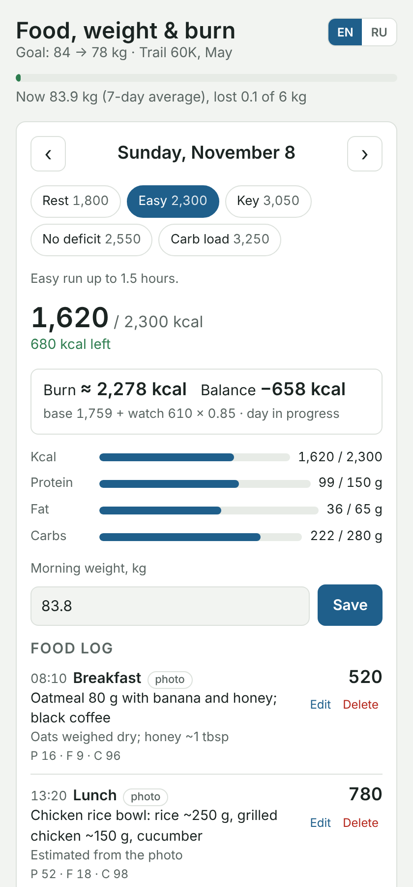
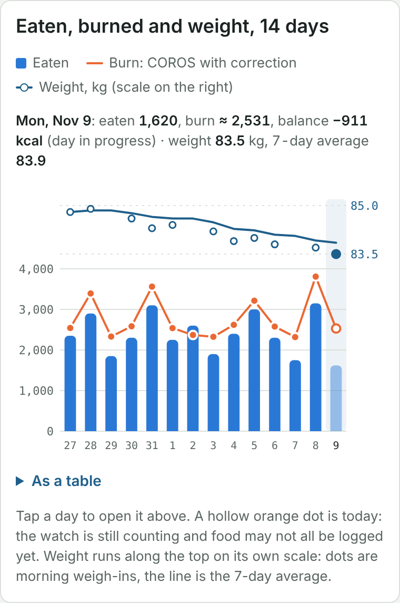

# COROS nutrition log for Claude

A food, weight and burn log that lives inside Claude. You send Claude a photo of your food, Claude estimates calories and macros and writes them to your log page. The page adds daily burn from your COROS watch, shows the balance, and over time learns how far your watch is off by comparing what you eat with your weight trend.

  
  

- Food log from photos, labels or a few words, with protein, fat and carbs
- Each meal keeps its photos and your own words; tap a thumbnail to see it full size
- A camera at the top of the page: snap a meal (with a comment if you like) and Claude estimates and logs it, snap the scale and Claude reads your weight, or snap a progress photo
- Progress photos by date, with that day's weight
- Targets per day type (rest, easy, key, maintenance, carb loading), worked out from what you usually burn and the pace your goal needs, or set by hand
- The day type picks itself from COROS: rest under 450 active kcal, key from 1,100, easy in between. Days ahead follow the workouts in your COROS training schedule, and today counts its planned workout from the morning. Tap a type to set it yourself; tap it again to hand it back to COROS
- For losing, gaining or keeping weight: the goal direction comes from your start and goal weight
- Burn = base metabolism × 1.2 + COROS active calories × a correction factor, fitted from your weight trend
- A goal weight and date: the pace you need (kg a week, kcal a day) next to your actual pace, and the planned path on the weight chart
- Morning weight with a 7-day average, weekly balance, and a 14-day chart of eaten vs burned with weight on top
- Any language: the page ships in English, and Claude translates it into the language you talk to it in, right-to-left scripts included

## What you need

- A Claude plan where artifacts can use your connected apps (Pro, Max, Team or Enterprise).
- **Create and edit files** (code execution) turned on in Claude's settings.
- The **COROS** connector added in Claude, for burn data. Without it the log works, just without burn and balance.

## Set it up

Write to Claude in a new chat:

> Set up the nutrition log from https://github.com/l3x4/claude-coros-nutrition-log

Claude reads [`SETUP.md`](SETUP.md), publishes the page for you and offers to save the logging rules as a skill named **coros-nutrition-log**: press **Save** on the card, so every chat knows how to log your food. Then open the page, allow it to read COROS when it asks, and fill **Profile** in Settings: sex, year of birth, height, start and goal weight, start and goal date. Training for a race? Set the goal date 2–3 weeks before it, so the taper and race week are at maintenance.

The page is yours: your entries are stored in your own private folder of it, which nobody else can read.

To get a newer version later, ask Claude to *update the nutrition log*: it republishes the page from this repository and your entries stay.

## Languages

The page ships in English. When you set it up in another language, or ask Claude to *translate my nutrition log into …*, Claude follows [`TRANSLATING.md`](TRANSLATING.md): it translates the page's text and saves the translation in your own storage. Switch languages in Settings. Arabic, Hebrew and other right-to-left languages get a mirrored layout and a matching font. A page update keeps your translation; anything new shows in English until Claude translates it.

## Use it

Talk to Claude in any chat:

- Send a photo: *breakfast*, *shared this pizza, I had a quarter*. What's in the photo counts as eaten.
- Describe without a photo: *two boiled eggs and toast with butter*.
- *Weight 82.4 this morning.*
- *Today is a key day*, *I'm carb loading tomorrow and the day after.*
- *How am I doing today?*

Days run from midnight to midnight, the same as COROS counts calories. When there's no label or weight in the photo, Claude looks the product up online instead of guessing.

Or log from the page itself: tap **Food** in the camera card to take a photo (or the gallery button next to it to pick some), add more photos if you like, a comment, and tap **Log it**. Claude estimates the meal right there (the first time, Claude asks you to allow it). If it can't, the meal is saved with its photos and marked *no estimate yet*; ask Claude in a chat to estimate it. **Scale** reads the weight off a photo of your scale's display; check the number and tap **Save**. **Progress photo** saves front, side or back photos under today's date.

You can also add or fix entries by hand on the page.

## How burn is calculated

- **Base**: Mifflin–St Jeor from your profile and 7-day average weight, × 1.2 for digestion and everyday movement. COROS doesn't count those: its active calories cover only workouts and brisk walking.
- **Active calories** come from COROS (the daily summary, nothing else is read) and are multiplied by a factor. It starts at 0.85, because wrist estimates of workouts usually run high.
- After 4 weeks with at least 10 weigh-ins and 14 logged days, the factor is fitted so that what you eat, minus the change in your weight (7,700 kcal per kg), matches your burn. That also absorbs systematic errors in the food estimates. You can fix the factor by hand in Settings.
- **Balance** = eaten − burned. Minus is a deficit, plus a surplus.
- **Suggested targets**: for each type of day, what you usually burn on that kind of day plus the daily balance your goal date needs. Losing takes more off rest days and less off key days; gaining does the reverse. Targets never go below your base metabolism.

## Repository

| Path | What it is |
|---|---|
| `index.html` | The page: one self-contained HTML file |
| `SETUP.md` | Setup steps for Claude |
| `TRANSLATING.md` | How Claude translates the page into another language |
| `skill/coros-nutrition-log/SKILL.md` | The skill: logging rules and data format for Claude |

## Disclaimer

Calorie estimates from photos are rough, about ±25% per plate, and watch burn estimates are rough too. This is a training log, not medical advice.

## License

MIT
