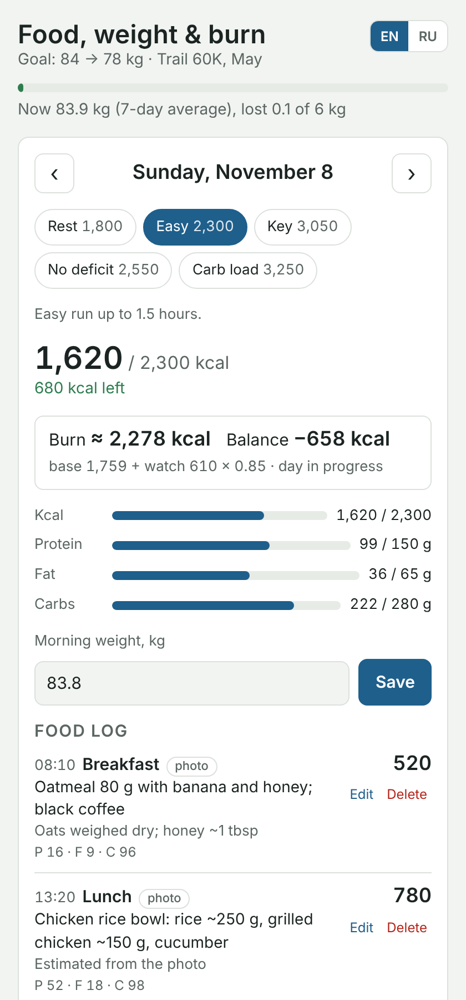
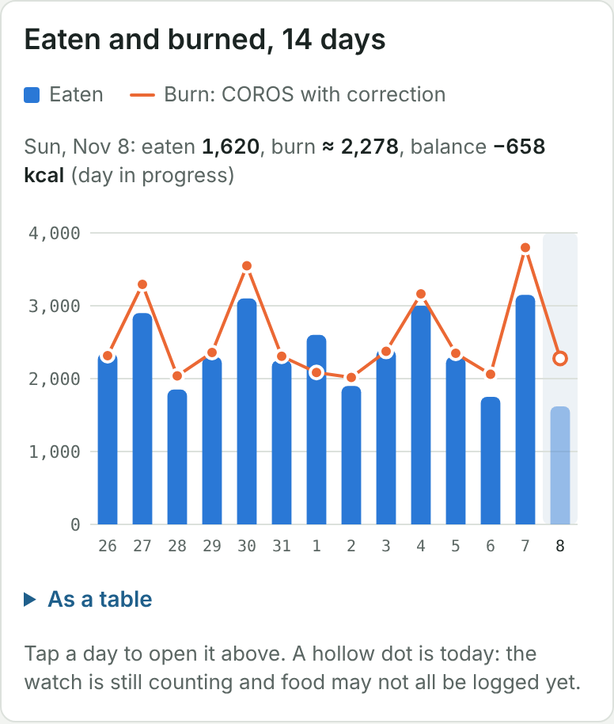

# Дневник питания с COROS для Claude

[English version](README.md)

Дневник еды, веса и расхода, который живёт внутри Claude. Присылаешь Claude фото еды, он оценивает калории и БЖУ и записывает их на твою страницу-дневник. Страница добавляет расход за день с часов COROS, показывает баланс и со временем выясняет, насколько ошибаются часы, сравнивая съеденное с трендом веса.

  
  

- Еда по фото, этикеткам или паре слов, с белками, жирами и углеводами
- Цели по типам дней: отдых, обычная, ключевая, без дефицита, углеводная загрузка; рассчитываются по профилю или задаются вручную
- Расход = базовый обмен + активные калории COROS × поправочный коэффициент, который подбирается по тренду веса
- Целевой вес и дата: нужный темп (кг в неделю, ккал в день) рядом с фактическим и план на графике веса
- Утренний вес со средним за 7 дней, баланс за неделю, график «съедено и расход» за 14 дней
- Английский и русский интерфейс: страница открывается на языке, на котором ты общаешься с Claude, а переключить его можно в настройках

## Что нужно

- Тариф Claude, в котором артефакты могут использовать подключённые приложения (Pro, Max, Team или Enterprise).
- Включённая в настройках Claude опция **Create and edit files** (выполнение кода).
- Коннектор **COROS** в Claude, для данных о расходе. Без него дневник работает, только без расхода и баланса.

## Как установить

Напиши Claude в новом чате:

> Настрой дневник питания из https://github.com/l3x4/claude-coros-nutrition-log

Claude прочитает [`SETUP.md`](SETUP.md), опубликует тебе страницу и предложит сохранить правила записи как навык **coros-nutrition-log**: нажми **Save** на карточке, чтобы в любом чате Claude знал, как записывать еду. Потом открой страницу, разреши ей читать COROS, когда она спросит, и заполни **Профиль** в настройках: пол, возраст, рост, стартовый и целевой вес, даты старта и цели. Готовишься к гонке — ставь дату цели за 2–3 недели до неё, чтобы подводка и неделя гонки были без дефицита.

Страница принадлежит тебе: записи хранятся в твоём личном разделе, который никто другой прочитать не может.

Чтобы потом получить новую версию, попроси Claude *обновить дневник питания*: он заново опубликует страницу из этого репозитория, записи сохранятся.

## Как пользоваться

Пиши Claude в любом чате:

- Фото: *завтрак*, *делили пиццу, я съел четверть*. Что на фото — то и съедено.
- Без фото: *два варёных яйца и тост с маслом*.
- *Вес утром 82,4.*
- *Сегодня ключевая*, *завтра и послезавтра углеводная загрузка.*
- *Как у меня сегодня?*

День заканчивается, когда ложишься спать, поэтому перекус после полуночи остаётся в своём вечере. Если на фото нет этикетки или веса, Claude ищет продукт в интернете, а не угадывает.

Записи можно добавлять и исправлять и вручную на странице.

## Как считается расход

- **Базовый обмен**: формула Миффлина — Сан Жеора по профилю и среднему весу за 7 дней.
- **Активные калории** берутся из COROS (только дневная сводка, больше ничего не читается) и умножаются на коэффициент. Сначала он 0,85, потому что часы обычно завышают.
- Через 4 недели, если есть хотя бы 10 взвешиваний и 14 дней с записями, коэффициент подбирается так, чтобы съеденное минус изменение веса (7700 ккал на кг) совпадало с расходом. Заодно это гасит систематическую ошибку в оценке еды. Коэффициент можно задать вручную в настройках.
- **Баланс** = съедено − расход. Минус значит дефицит.

## Что в репозитории

| Путь | Что это |
|---|---|
| `index.html` | Сама страница, один HTML-файл |
| `SETUP.md` | Шаги установки для Claude |
| `skill/coros-nutrition-log/SKILL.md` | Навык: правила записи и формат данных для Claude |

## Оговорка

Оценка калорий по фото грубая, примерно ±25% на тарелку, и расход по часам тоже приблизительный. Это дневник для тренировок, а не медицинский совет.

## Лицензия

MIT
